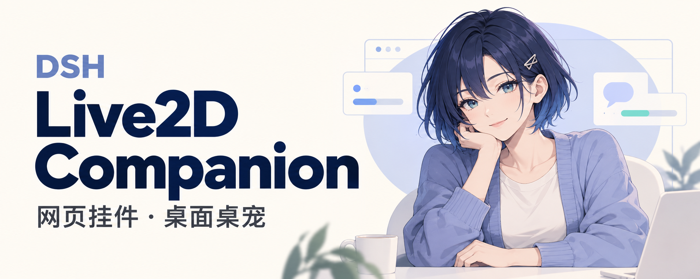
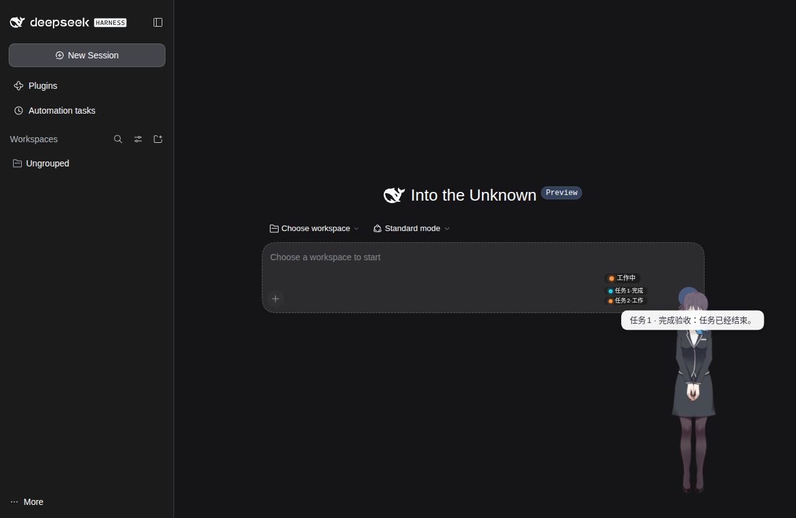
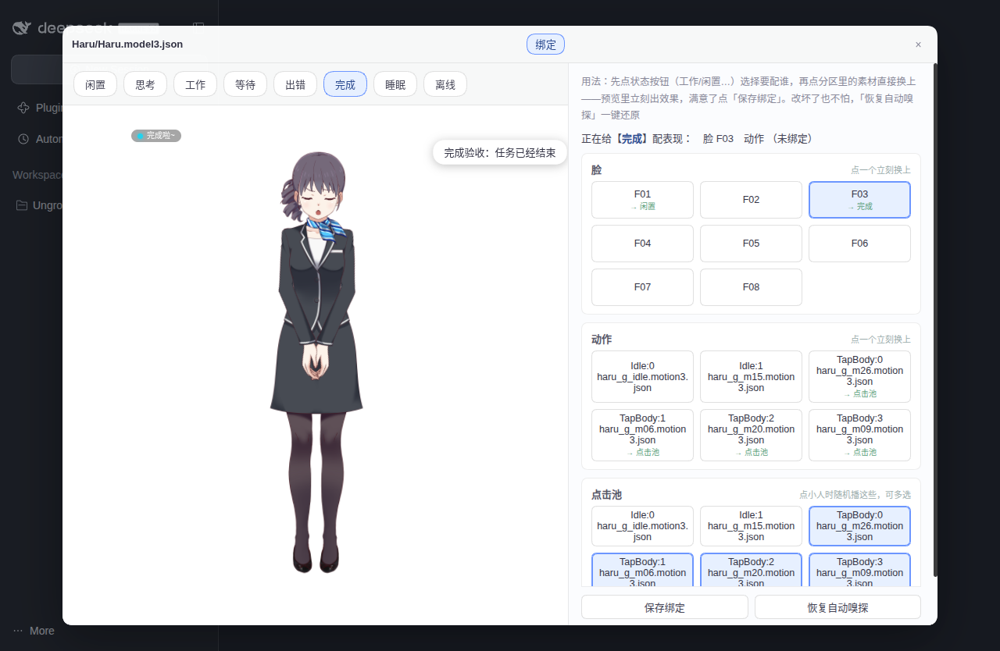

# DSH Live2D Companion

<p align="center">
  
</p>

<p align="center">
  <strong>让 AI 的工作状态，有一点表情。</strong><br>
  看进度、等确认、收完成提醒，也让喜欢的角色陪在桌面上。
</p>

<p align="center">
  <a href="https://github.com/Tisitan/dsh-live2d-companion/releases/latest"></a>
  <a href="https://github.com/Tisitan/dsh-live2d-companion/actions/workflows/ci.yml"></a>
  <a href="LICENSE"></a>
</p>

<p align="center">
  <a href="#实际界面">实际界面</a> · <a href="#选择运行方式">选择运行方式</a> · <a href="#快速开始">快速开始</a> · <a href="docs/configuration.md">配置与模型</a> · <a href="docs/development.md">开发文档</a>
</p>

[DeepSeek Harness（DSH）](https://github.com/deepseek-ai/deepseek-harness) 的 Live2D 状态伴侣。将任务事件变成角色的表情、动作、状态灯和气泡，支持网页挂件与 Electron 桌宠；也能通过独立版接入 Codex / OpenCode。

**模型由你选择。** 支持接入兼容的 Cubism 4/5 模型，按模型已有的表情和动作适配。仓库不附带可运行的角色模型或 Cubism Core；上方头图为原创宣传插画。

## 能做什么

| 功能 | 日常体验 |
| --- | --- |
| **任务状态** | 闲置、思考、工作、待确认、出错、完成、睡眠、离线；并行任务各有一枚状态灯 |
| **完成提醒** | 完成气泡独立提示，其他任务仍在工作时，主灯继续显示整体状态 |
| **桌面互动** | 点击、摸头、拖动、缩放、视线跟随；桌宠支持自动穿透与手动锁定 |
| **角色定制** | 导入与热切换模型，预览表情动作，为不同状态保存绑定，编辑气泡台词 |
| **休息一局** | 五子棋与国际象棋，本地 AI 离线可玩；DSH 在线模式可添加模型解说或模型执子 |
| **独立陪伴** | Codex 状态联动；OpenCode 额外提供聊天、角色档案、日记、记忆与游戏解说 |

## 实际界面

<table>
  <tr>
    <td width="50%"><a href="docs/assets/widget-and-tasks.png"></a></td>
    <td width="50%"><a href="docs/assets/model-binding.png"></a></td>
  </tr>
  <tr>
    <td><strong>进度在身旁</strong><br>并行任务独立显示，完成气泡避让任务灯。</td>
    <td><strong>表情由你来配</strong><br>选择状态 → 预览素材 → 保存绑定，主挂件即时更新。</td>
  </tr>
</table>

点击图片查看大图。以上为 v1.2.3 隔离测试环境的真实截图，使用官方 Haru 示例模型；截图中的角色不随项目分发。[素材与版权说明](docs/assets/README.md)。

## 选择运行方式

| | DSH 插件 | 独立桌宠 |
| --- | --- | --- |
| 适合谁 | 已在使用 DSH | 使用 Codex / OpenCode，或只想运行桌宠 |
| 显示形态 | 网页挂件，或可选的桌面桌宠 | 桌面桌宠 |
| 状态来源 | DSH 会话事件 | Codex / OpenCode 生命周期事件 |
| 模型服务 | DSH 在线游戏解说与模型执子 | OpenCode 聊天、日记、记忆与游戏解说 |
| 离线游戏 | 五子棋、国际象棋，本地 AI | 五子棋、国际象棋，本地 AI |
| 安装入口 | 下方快速开始 | [独立版安装与连接说明](standalone/README.md) |

Codex 在独立版中提供状态联动，聊天需要 OpenCode。独立版的游戏对手为本地 AI，不提供 DSH 的模型执子模式。

## 快速开始

### DSH 插件

**准备环境。** 推荐 Node.js 24。本轮验证使用 DSH `0.2.1-rc.2`、Node.js `24.21.0` 与 Electron `43.8.3`。插件包声明 Node.js ≥18，安装 Electron 需 ≥22.12；运行 DSH 还需满足宿主自身的版本要求。

**1. 安装插件，定位插件目录。**

```sh
dsh plugin --profile web add github:Tisitan/dsh-live2d-companion
```

随后进入 `<DSH_HOME>/profiles/web/node_modules/dsh-live2d-companion/`。未自定义 `DSH_HOME` 时，通常为用户目录下的 `.dsh`；例如 Windows 的 `%USERPROFILE%\.dsh`。下方 `public/` 和 `pet/` 路径均相对于这个插件目录。

**2. 放入模型和 Cubism Core。**

```text
插件目录/
├── public/
│   ├── model/
│   │   └── MyModel/           # 完整模型目录，保留贴图、动作等相对路径
│   │       ├── MyModel.model3.json
│   │       └── …
│   └── vendor/
│       └── live2dcubismcore.min.js
└── pet/
```

模型需自行准备并遵守原作者许可；请从 [Live2D 官方 SDK for Web 下载页](https://www.live2d.com/en/sdk/download/web/)按其许可说明获取 `live2dcubismcore.min.js`，再放入上述目录。

**3. 指定自己的模型。**

编辑 `<DSH_HOME>/profiles/web/cordis.patch.yml`。没有 `live2d-companion` 条目时加入下列配置；已有条目则编辑原项，避免重复 id。保留文件中的其他插件配置。

```yaml
- insert:
    - id: live2d-companion
      name: dsh-live2d-companion
      config:
        model: 'MyModel/MyModel.model3.json'
        widget: true
        pet: false
```

将示例路径替换成自己的 `.model3.json`。插件内置的默认模型未随仓库分发，首次使用需要指定模型。打开 DSH 登录入口并刷新网页，即可检查挂件；之后可通过齿轮面板切换或导入模型。

**4. 可选：启用桌面桌宠。**

在插件目录执行以下命令。Windows PowerShell 如遇脚本策略限制，将 `npm` 换成 `npm.cmd`。

```sh
npm ci --prefix pet
node pet/node_modules/electron/install.js
```

第二条命令用于下载 Electron 二进制，不能省略。完成后将上述配置中的 `pet` 改为 `true`；仅需桌宠时再将 `widget` 改为 `false`。配置热重载后生效；网页挂件的增删需要刷新页面。

### 独立桌宠

Windows 下下载完整源码或克隆仓库，准备 Node.js ≥22.12，将 Core 放入 `public/vendor/`，然后运行：

```powershell
.\standalone\setup.cmd
.\standalone\start.cmd
```

首次缺少模型时，应用会提示模型目录并退出。把完整模型目录复制到提示位置后，再次运行 `.\standalone\start.cmd`。需要联动时，运行 `standalone/连接Codex和OpenCode.cmd`，再重启对应工具；Codex 首次使用还需按安装器提示在 `/hooks` 中信任新增钩子。[查看独立版完整说明](standalone/README.md)。

## 日常操作

| 想做什么 | 操作 |
| --- | --- |
| 移动与缩放 | 拖动角色；网页挂件使用滚轮，桌宠使用 Ctrl + 滚轮；拖动期间锁定缩放 |
| 切换或导入模型 | 齿轮面板 → 模型列表 / 导入模型 |
| 自定义状态表情 | 模型「查看」→「绑定」→ 选择状态与素材 →「保存绑定」 |
| 修改气泡台词 | 「词」按钮 → 编辑台词池 / 另存预设 |
| 避免鼠标误触 | 桌宠「🔒」强制模型穿透；再次点击恢复自动模式 |
| 玩游戏 | 「🎮」打开游戏中心；桌宠使用独立卡片窗口 |
| 退出或重启 | 桌宠面板内操作；退出需双击确认，主动退出后不会被误拉起 |

桌宠默认覆盖主屏，未提供跨屏拖动。点击游戏卡片或输入控件会正常取得焦点。更多行为、帧率、台词节奏和模型绑定见[配置文档](docs/configuration.md)。

## 更新与常见问题

**看不到角色？** 先确认 Core 文件和完整模型已放入正确目录，配置路径相对于 `public/model/`；模型加载失败会显示提示。桌宠未启动时，再检查 Electron 二进制是否完成下载。

**状态不同步？** DSH 模式请从宿主登录入口进入；独立版确认连接脚本已安装，并重启了 Codex / OpenCode。调试入口见[开发文档](docs/development.md)。

**更新前备份什么？** DSH 模式的模型、`profile.json`、`model-selection.json`、Core、自定义台词预设和生效指针位于插件目录，应先备份。独立版的导入模型、角色档案、日记与记忆保存在 Electron 用户数据目录。

最新维护版 [v1.2.3](https://github.com/Tisitan/dsh-live2d-companion/releases/tag/v1.2.3) 修复了完成通知、拖动缩放、模型列表刷新、主动退出、OpenCode 超时恢复和国象规则，并改进气泡布局。[查看完整发布说明](https://github.com/Tisitan/dsh-live2d-companion/releases/latest)。

## 文档与开发

| 文档 | 内容 |
| --- | --- |
| [配置与模型](docs/configuration.md) | patch 配置、台词预设、模型接入、状态绑定与面板操作 |
| [独立版](standalone/README.md) | 安装、Codex / OpenCode 连接、角色档案与记忆 |
| [开发指南](docs/development.md) | 架构、扩展 API、接口、调试、测试与发布 |
| [Releases](https://github.com/Tisitan/dsh-live2d-companion/releases) | 版本说明、安装包与校验和 |
| [Issues](https://github.com/Tisitan/dsh-live2d-companion/issues) | 缺陷反馈与功能建议 |

本地运行 `npm test`；[CI](https://github.com/Tisitan/dsh-live2d-companion/actions/workflows/ci.yml) 覆盖 Linux / Windows、Node 22 / 24，以及真实 Windows Electron 窗口。v1.2.3 另做了真实 Haru、官方 DSH Desktop 代理/预载和退出行为的隔离验收。物理 GPU、多屏、动态 DPI 切换及完整 Desktop 安装更新流程仍需对应环境验证。

## 许可与致谢

代码采用 [MIT](LICENSE)。项目使用 pixi.js、pixi-live2d-display 与 Electron；模型和 Cubism Core 受各自许可约束，需要自行获取。

真实截图使用 Haru © Live2D Inc.。截图内容使用 Live2D Inc. 拥有著作权的样例数据，依照该公司规定的使用条件使用，由本项目作者自行制作。[样例条款](https://www.live2d.com/en/learn/sample/model-terms/) · [素材说明](docs/assets/README.md)。
