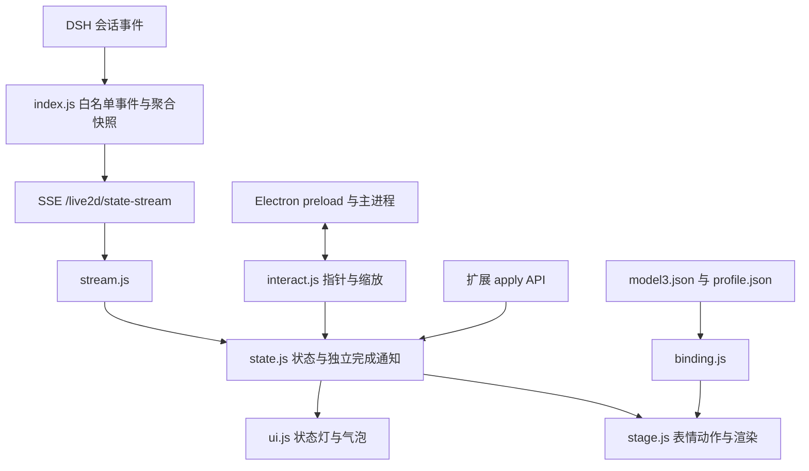

# 开发、调试与发布

[返回首页](../README.md) · [配置与模型绑定](configuration.md) · [独立版说明](../standalone/README.md) · [版本发布记录](https://github.com/Tisitan/dsh-live2d-companion/releases)

## 源码结构与数据流

DSH 插件入口是 [index.js](../index.js)。它通过 Cordis patch 接入宿主，注册 `/live2d/*` 路由、订阅会话事件、维护聚合状态，并按配置管理 Electron 桌宠。网页挂件与桌宠加载同一套前端；独立版提供自己的本地服务和连接适配器。



| 路径 | 职责 |
|---|---|
| [index.js](../index.js)、[host-auth.mjs](../host-auth.mjs) | DSH 路由、鉴权、配置/模型文件管理、状态聚合、游戏服务 |
| [pet-lifecycle.mjs](../pet-lifecycle.mjs) | 进程凭据读写与存活探测，供宿主收养和恢复逻辑使用 |
| [public/boot.js](../public/boot.js) | 前端初始化、事件总线、公共 API、扩展加载 |
| [public/src/config.js](../public/src/config.js) | 环境常量、localStorage、台词配置加载 |
| [public/src/binding.js](../public/src/binding.js)、[stage.js](../public/src/stage.js) | 模型素材绑定、PIXI 加载、模型切换、缩放和渲染 |
| [public/src/state.js](../public/src/state.js)、[stream.js](../public/src/stream.js) | 状态行为、SSE 消费、完成通知去重 |
| [public/src/ui.js](../public/src/ui.js)、[interact.js](../public/src/interact.js) | 状态灯/气泡、输入、拖动、穿透矩形上报 |
| [public/src/panel.js](../public/src/panel.js) | 模型、绑定、台词与设置面板 |
| [public/src/game.js](../public/src/game.js)、[public/src/games/](../public/src/games/) | 通用游戏卡片和各游戏棋盘渲染器 |
| [games/](../games/) | 游戏注册表、引擎、AI、描述符和解说协议 |
| [pet/main.js](../pet/main.js)、[pet/preload.js](../pet/preload.js) | Electron 窗口、登录会话、IPC、光标轮询、健康检查 |
| [pet/passthrough.cjs](../pet/passthrough.cjs) | 主进程穿透判定 |
| [standalone/](../standalone/) | 独立服务、桌面入口及 Codex/OpenCode 适配 |

`boot.js` 大致按配置 → UI → 渲染 → 状态 → 交互/聊天/状态流 → 面板的顺序装配。主要能力通过共享 `ctx` 在运行期调用，模块也会导入配置和绑定等辅助模块；修改初始化顺序时要检查这些依赖。

宿主和前端都参与状态处理。宿主维护每会话状态、任务编号及聚合快照；前端单会话优先使用原始事件，原始通道静默超过 10 秒才接受聚合覆盖，多会话则以聚合状态为主灯依据。完成气泡独立于主灯。事件顺序和断线边界见[配置文档](configuration.md#状态与表现映射)。

增加游戏时，在 `games/<id>/` 实现引擎、AI 和描述符，并由宿主及独立版入口登记到注册表；描述符契约见 [registry.mjs](../games/registry.mjs)。前端按 ID 动态加载 `public/src/games/<id>.js`。还要检查 `game.js` 的主题配置，以及 `pet/main.js`、`standalone/main.cjs` 的原生卡片尺寸表和 ID 白名单，不能只增加一个渲染器文件就假定所有入口已接通。

## 路由与宿主接口

| 路由 | 用途 |
|---|---|
| `GET /live2d/state-stream` | SSE：`{ev,n}`、`{state,sessions}`、`{model}`；首帧可合并快照与模型 |
| `GET /live2d/state`、`/live2d/config` | 当前状态与前端配置 |
| `GET /live2d/models` | 当前/默认模型及模型列表 |
| `POST /live2d/model` | 选择、恢复默认或删除模型 |
| `POST /live2d/import`、`/live2d/profile` | 文件导入、绑定保存或删除 |
| `GET /live2d/quips-config`、`POST /live2d/quips` | 台词预设列表、保存、选择或删除 |
| `POST /live2d/mode` | 修改当前 profile 中本插件的显示模式配置 |
| `/live2d/game/list`、`models`、`presets`、`state`、`new`、`move` | 游戏目录、设置、快照与走子接口 |
| `GET /live2d/*` | 经过路径检查的前端、模型及 vendor 静态资源 |

全部路由先走 DSH `connection.requestRejection`；写入路由再检查回环地址和浏览器同源条件。桌宠启动还使用 `connection.authenticatedUrl` 与 `webServer.getOrigin`，将根登录链接交给主进程换取 cookie。页面加载和心跳共用同一个 Electron session。旧宿主缺少必要鉴权接口时不会放开匿名访问。

首页注入分别适配 HTTP `tapIndex` 和 Desktop `webserver/index-inject` 事件。修改注入逻辑时应覆盖两个入口，不能只测 HTTP 页面。

## 本地开发

建议使用独立的 DSH_HOME、测试 profile 和空闲端口。不要把正式配置、个人模型或凭据复制进提交。先完成[安装](../README.md)和资源准备，再将源码检出链接到测试 profile 的 `node_modules/dsh-live2d-companion`，通过同名 patch 行加载。

宿主插件声明 Node.js ≥18；当前 Electron 安装工具链要求 Node.js ≥22.12，实际运行 DSH 还需满足宿主自己的 Node.js 要求。建议使用 Node.js 24。依赖准备步骤以[首页安装说明](../README.md)为准；从仓库根目录可执行：

```sh
npm test
npm ci --prefix pet
# 仅在需要独立版时安装其桌面依赖
npm ci --prefix standalone
```

手动启动 `pet/` 时，在私有终端设置 `L2D_URL` 为测试实例的 `/live2d/pet.html`，`L2D_AUTH_URL` 为同一实例的根登录链接，然后运行：

```sh
npm start --prefix pet
```

登录链接含凭据，不要写进源码、截图或 issue。由 DSH 启动时无需手工设置这些变量。桌宠具有单实例锁；进行并行实验时需隔离 Electron 用户数据目录，避免与正在使用的桌宠争用实例。

前端文件修改通常刷新页面即可；宿主插件、路由和进程管理修改需重新加载测试插件。测试用的真实模型/Core 保留在本地 `public/model/` 和 `public/vendor/`，不提交或打进公开包。

## 扩展 API

在 `public/extensions/` 放 ES Module，并把文件名加入 [index.json](../public/extensions/index.json)。加载器只接受纯 `.js` 文件名，按清单顺序导入并调用默认导出或具名 `apply`：

```js
// public/extensions/my-feature.js
export default function apply(api) {
  api.on('enter', (next, prev) => {
    console.debug('Live2D state:', prev, '→', next)
  })
  api.showBubble('扩展已加载', 3000)
}
```

```json
["hourly-chime.js", "my-feature.js"]
```

清单修改后刷新页面或重载桌宠。删除清单条目不会取消当前页面里已创建的定时器。示例扩展是 [hourly-chime.js](../public/extensions/hourly-chime.js)。预览 iframe 不加载扩展。

`apply(api)` 的参数与页面控制台的 `window.__l2d` 相同：

| API | 说明 |
|---|---|
| `enter(state)` | 进入已注册状态；同名状态或未注册名称不改变状态 |
| `showBubble(text, ms)` | 普通优先级气泡，可能被正在显示的高级气泡挡住；返回是否显示 |
| `on(event, fn)` | 订阅事件，返回退订函数 |
| `registerState(name, def)` | 浅合并状态定义：`expr`、`motion`、`pool`、`rotate`、`remotionMs`、`transientMs`、`then` |
| `registerLamp(name, spec)` | 浅合并灯的 `color`、`label`、`anim`；自定义动画需自行添加 CSS |
| `quip(pool)` | 随机抽取台词；不存在的池返回空串 |
| `setModel(path)` | 请求前端模型热切换，返回 Promise；不代替宿主持久化选择接口 |
| `refreshModels()` | 从宿主重新读取模型列表 |
| `openModelPanel()` / `closeModelPanel()` | 打开/关闭模型面板 |
| `openModelViewer(path)` / `importModels(files)` | 打开预览 / 导入模型文件 |
| `rawExpr(name)` / `rawMotion(group, index)` | 按素材原名试穿，绕过语义槽位 |
| `openChat()` | 打开可用的聊天面板；没有对应功能时无操作 |
| `state`、`binding`、`model`、`modelPath`、`modelList` | 当前状态和模型相关 getter |
| `app`、`scale`、`targetScale`、`bounds`、`gaze` | 渲染实例、缩放、模型边界和视线 getter |
| `ctx` | 实验性共享上下文，内部结构可能随版本调整 |

getter 没有 setter，但返回的 `model`、`binding`、`app` 等对象不是不可变快照。`modelList` 每次读取返回当前列表的新数组；预览没有模型面板，返回空数组，也不提供面板相关方法。

事件为 `enter(next, prev)`、`raw(ev)`、`model(modelPath)`、`ready(api)`。扩展在 `ready` 发出前加载，因此可在 `apply` 内订阅就绪事件。原始 `raw` 钩子只收到事件名，不包含会话号和事件正文。

加载器会捕获导入/`apply` 失败，事件总线会捕获同步监听器异常并继续调用其他监听器。这不是执行沙箱：扩展与页面同源，可以访问 DOM 和共享对象；异步任务、定时器或自行修改核心状态仍可能影响页面。扩展应自行处理 Promise 拒绝和资源清理。

## 调试入口

常用控制台命令：

```js
window.__l2d.state
window.__l2d.binding
window.__l2d.modelList
window.__l2d.bounds
window.__l2d.enter('thinking')
window.__l2d.rawExpr('F03') // 仅适用于实际存在该素材的模型
```

普通页面的手动状态可能被后续 SSE 覆盖；要持续观察一个状态，使用模型预览。DevTools 网络面板可以检查模型贴图、Core、`profile.json` 与 SSE 是否加载成功。

| 桌宠变量 | 用途 |
|---|---|
| `L2D_URL` | 完整目标页面 URL |
| `L2D_AUTH_URL` | 同源根登录链接，只交给主进程；主进程读取后从自身环境中删除 |
| `L2D_MODEL` | 未指定 `L2D_URL` 时，附加到默认页面 URL 的临时模型参数 |
| `L2D_DEBUG=1` | 启用 9222 远程调试端口和部分诊断日志 |
| `L2D_SOFT=1` | 禁用硬件加速，用于排查渲染路径问题；也可通过面板持久化设置 |
| `L2D_PIDFILE` | 宿主管理用进程凭据文件位置，一般由宿主注入 |

仓库中的 [pet/cdp-probe.mjs](https://github.com/Tisitan/dsh-live2d-companion/blob/main/pet/cdp-probe.mjs) 是面向 Windows 的 CDP/界面诊断脚本：它连接本地 9222 端口，会通过 PowerShell 移动系统光标、操作 UI 并保存截图。仅在隔离测试桌面中按需使用，先阅读源码。调试端口也应只用于受控的本地环境。软渲染会增加 CPU 开销，不能据此保证解决所有合成器或驱动问题。

## Overlay、穿透与生命周期

桌宠主窗口覆盖**主显示器工作区**。正常拖动只改变画布里的模型位置，不移动原生窗口；模型中心坐标在松手后保存。系统工作区变化和部分恢复路径仍可能调整窗口 bounds，因此不应把它描述为整个生命周期都不移动。

渲染层上报模型/UI 矩形以及拖动、手动穿透状态；[passthrough.cjs](../pet/passthrough.cjs) 在主进程结合 OS 光标位置决定输入是否穿透。模型区域停留约 600ms、位移不超过 24px 后才开放交互，UI 控件即时可用。手动锁定穿透让模型区域不响应鼠标，保留 UI 入口。游戏卡片区域作为穿透排除区，避免透明层截获卡片输入。

网页挂件使用 DOM 拖动；桌宠使用模型画布拖动，两者在拖动期间都锁定缩放。松手、取消、失焦以及拖动看门狗负责收尾。桌宠缩放要求 Ctrl+滚轮，网页挂件接受普通滚轮。

Windows overlay 默认 `focusable:false`；含输入的面板打开时可临时放行焦点。游戏卫星窗使用 `focusable:true`，点击卡片取得焦点是预期行为。Linux 的窗口管理器行为不同，不应从 Windows 配置推导出相同的焦点保证。

当前实现主要覆盖主屏。独占全屏应用可能盖住桌宠；物理 GPU、多屏、运行中换屏、Wayland 和 macOS 仍需对应环境验证。停留后再交互减少穿透切换频率，但不能保证所有播放器和合成器都无闪烁。

宿主通过进程凭据和监督逻辑管理重启、收养和卸载。桌宠手动退出使用专用退出原因，防止被当作崩溃立即重拉；健康检查失败与意外退出走恢复路径。改动这些逻辑时，需同时验证“故障可恢复”和“用户主动退出后保持停止”，不能只检查进程曾成功启动。

## 游戏卫星窗与分数 DPI

五子棋和国际象棋的卡片目标尺寸为 760×650 DIP，创建时受主屏工作区约束。卡片内容适配缩小后的空间，必要时滚动访问侧栏。

Windows 使用 `thickFrame:false` 和外框尺寸语义，保存创建时的目标宽高。拖动与 80ms 尺寸恢复计时器都通过 `setBounds` 复用该目标；不把 `getSize()` 在分数 DPI 下的舍入结果反复作为新目标。非 Windows 分支仍使用内容区尺寸语义。

验证时同时记录 DIP bounds 和原生像素：DIP 读回可能有 1 单位舍入差异，应检查连续拖动后的物理尺寸是否稳定。当前 Windows CI 覆盖 1 与 1.5 缩放，以及 1920×1080、1024×768 的测试显示配置；这不等于验证了运行中系统 DPI 变化或所有多屏组合。

## 测试与发布

在仓库根目录运行：

```sh
npm test
node --test frontend-state.test.mjs frontend-api.test.mjs frontend-interact.test.mjs
npm pack --dry-run --json
```

`npm test` 覆盖游戏引擎/AI、前端行为、路由和鉴权、桌宠监督、角色档案与独立版适配器。它使用临时目录和测试端口，不要求真实 DSH、模型、Core 或外部模型服务。前端行为测试在受控 DOM/渲染边界下执行真实模块，不能替代实际 WebGL 与原生窗口验收。

OpenCode SDK 契约测试在普通本地执行时会跳过未安装的可选 SDK。要运行它，可安装固定版本到独立临时目录，并将 `L2D_OPENCODE_SDK_CLIENT` 指向 `@opencode-ai/sdk/dist/client.js` 后执行 `npm test`。当前 CI 使用 SDK 1.19.4，向本地 HTTP 测试服务验证取消和错误恢复，不调用外部模型。

[CI 工作流](https://github.com/Tisitan/dsh-live2d-companion/blob/main/.github/workflows/ci.yml) 当前运行 Linux Node 22/24、Windows Node 24，另运行真实 Windows Electron 窗口、游戏卡片布局和主动退出测试。主测试与桌面测试的范围不同；报告结果时应分别列出环境、是否有真实模型、是否使用软件渲染和外部服务。

提交前还应检查打包清单：模型、Cubism Core、`node_modules`、个人配置和登录凭据不应进入公开包。新增运行时辅助文件需加入 `package.json` 的 `files`；文档相对链接指向的文件也应在发布形式中可用。

维护者发布流程由 [release.yml](https://github.com/Tisitan/dsh-live2d-companion/blob/main/.github/workflows/release.yml) 定义：

1. 通过 PR 将版本变更和 `docs/releases/v<版本>.md` 合并到 `main`。
2. 从已合并的目标提交创建 `release/v<版本>` 分支。例如将 `X.Y.Z` 替换为真实版本后执行：

   ```sh
   git fetch origin
   git switch -c release/vX.Y.Z origin/main
   git push origin release/vX.Y.Z
   ```

3. Release 工作流检查提交已包含在 `main`、分支名与稳定版本一致，并复用完整 CI。
4. 验证通过后生成插件 TGZ、源码 ZIP 与 `SHA256SUMS`，创建对应 GitHub 标签和 Release。已有标签不会被覆盖。

普通 `main` 推送不触发发布。本流程使用 `npm pack` 生成归档，不执行 `npm publish`，也不会把版本安装到现有 DSH。工作流中途失败时先核对标签和 Release 状态，再决定恢复操作，避免直接重复创建同版本发布。
